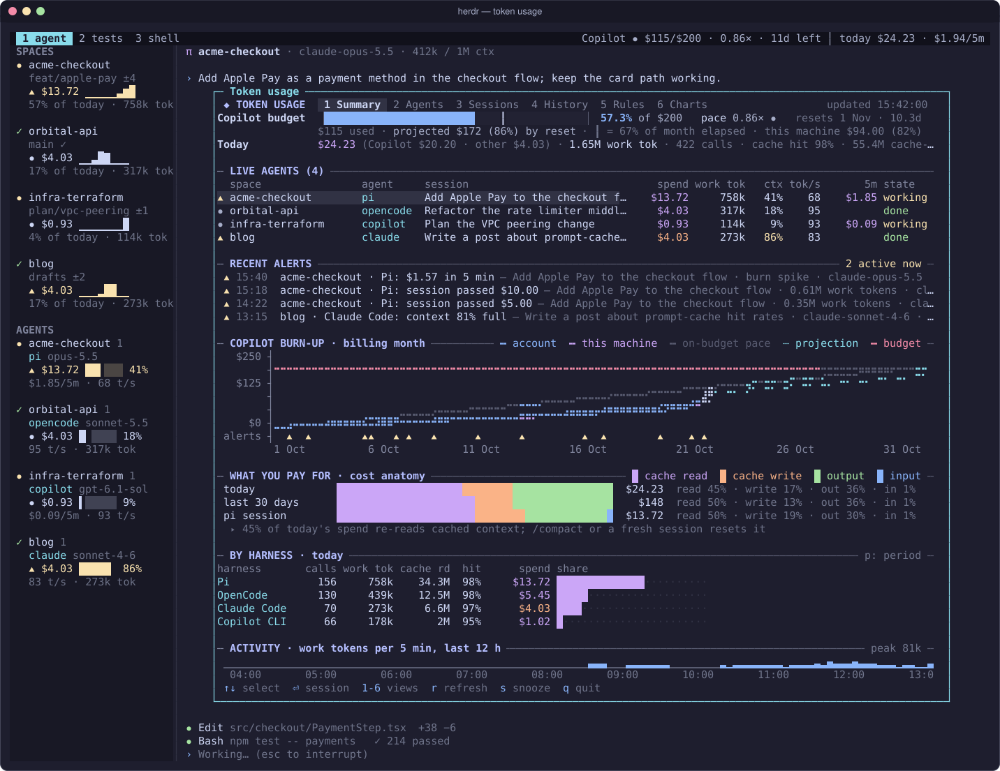

<p align="center">
  
</p>

<h1 align="center">Token Usage for herdr</h1>

<p align="center">
  Live spend, GitHub Copilot credits, context and speed for every coding agent you run in <a href="https://herdr.dev">herdr</a>.
</p>

<p align="center">
  <a href="https://github.com/pseudovar/herdr-plugin-token-usage/actions/workflows/ci.yml"></a>
  <a href="https://github.com/pseudovar/herdr-plugin-token-usage/releases"></a>
  <a href="https://pseudovar.github.io/herdr-plugin-token-usage/"></a>
  <a href="LICENSE"></a>
</p>

<p align="center">
  
</p>

Coding agents bill in different units. GitHub Copilot (used by Pi, OpenCode and
Copilot CLI) spends AI credits against a monthly allowance, while Claude Code on an
API plan spends dollars. Each harness writes its own usage records, in its own format.

This plugin reads those records on your machine, read-only, and shows in herdr:

- **The sidebar:** each agent's spend today, a context gauge, its 5-minute burn
  and output speed. Each space gets its total and hourly activity.
- **The tab bar:** your Copilot budget and pace for the month, and today's
  total across every harness.
- **A dashboard** (`prefix+u`):
  - a Copilot burn-up chart and cost anatomy;
  - per-call session detail and 30-day history;
  - a compaction advisor, a model what-if and a spend treemap.
- **Alerts** for pace, quota, full context windows, expensive sessions, burn
  spikes and cache misses. Every rule is editable in the dashboard.

It supports Pi, OpenCode, GitHub Copilot CLI and Claude Code. It needs no
proxies, no API keys and no background process, and it has no npm dependencies.

## Install

You need herdr 0.9.1 or later and Node.js 22.18 or later, on macOS or Linux. The
GitHub CLI (`gh`) is optional; it's used for the Copilot quota.

```bash
herdr plugin install pseudovar/herdr-plugin-token-usage
herdr plugin action invoke pseudovar.token-usage.setup                    # writes the `tu` launcher
~/.local/state/herdr/plugins/pseudovar.token-usage/bin/tu setup --apply         # sidebar rows, tab bar, keys, toasts
~/.local/state/herdr/plugins/pseudovar.token-usage/bin/tu setup --integrations  # exact pane → session mapping
```

`setup --apply` shows a diff of `~/.config/herdr/config.toml`, asks first, keeps a
backup and reloads herdr. Then press `prefix+u`.

## Documentation

**[pseudovar.github.io/herdr-plugin-token-usage](https://pseudovar.github.io/herdr-plugin-token-usage/)**

- [Install](https://pseudovar.github.io/herdr-plugin-token-usage/guide/install) and [set up herdr](https://pseudovar.github.io/herdr-plugin-token-usage/guide/setup)
- [Sidebar and tab bar](https://pseudovar.github.io/herdr-plugin-token-usage/guide/sidebar-and-tab-bar), [dashboard](https://pseudovar.github.io/herdr-plugin-token-usage/guide/dashboard), [charts](https://pseudovar.github.io/herdr-plugin-token-usage/guide/charts)
- [Alerts and rules](https://pseudovar.github.io/herdr-plugin-token-usage/guide/alerts), [configuration](https://pseudovar.github.io/herdr-plugin-token-usage/reference/configuration), [CLI](https://pseudovar.github.io/herdr-plugin-token-usage/reference/cli)
- [Harnesses and accuracy](https://pseudovar.github.io/herdr-plugin-token-usage/guide/harnesses), [how it works](https://pseudovar.github.io/herdr-plugin-token-usage/guide/how-it-works), [troubleshooting](https://pseudovar.github.io/herdr-plugin-token-usage/guide/troubleshooting)

## Privacy

Harness data is opened read-only, and only usage fields are kept (tokens, model,
timing, cost). Prompts and responses are never stored or shown. Everything stays
in `~/.local/state/herdr/plugins/pseudovar.token-usage/`. The only network call is
the optional Copilot quota lookup through your existing `gh` login.

## Contributing

Issues and pull requests are welcome; see [CONTRIBUTING.md](CONTRIBUTING.md).
Releases follow [Semantic Versioning](https://semver.org) and are listed in the
[changelog](CHANGELOG.md).

## License

[MIT](LICENSE). Not affiliated with herdr, GitHub or Anthropic.
